  

<section>
  <h1>Blog</h1>
  <h2>Ensayos, micro-blogs y escritos didácticos</h2>

  <strong>En camino</strong>

  

    <a style="margin-bottom: 20px;" class="btn btn-primary" href="{{ '/feed.xml' | relative_url }}"> <i class="fa-solid fa-square-rss"> Feed RSS  </i>  </a>
  
 
  
  
    
    

      
      

        
      

      

      

        

          {{ post.date | date_to_string }} &raquo;
            
              <a href="{{ post.external_url }}" target="_blank" title="{{ project.name }}">
                {{ post.title }}
              </a>
            
              <a href="{{ post.url | prepend: site.baseurl }}" title="{{ project.name }}">
                {{ post.title }}
              </a>
            
          
        

        

          {{ post.short_description }}
        

      

      
      

        
      

      
    

  
</section>

