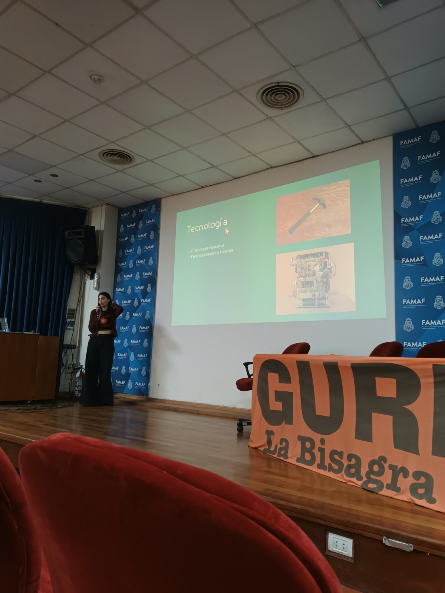
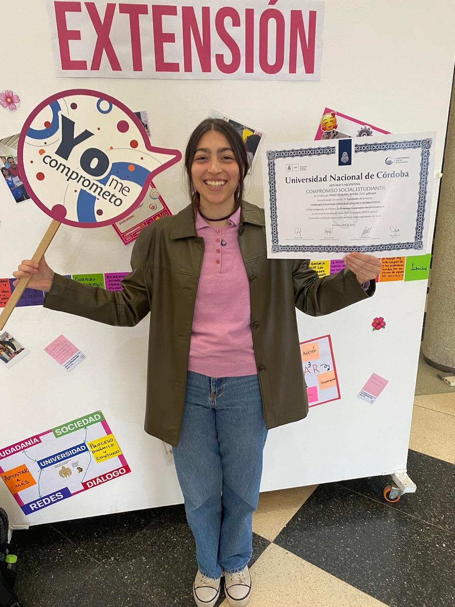

<h1>Fotos</h1>

<!--
Source - https://stackoverflow.com/q/41604263
Posted by zjffdu, modified by community. See post 'Timeline' for change history
Retrieved 2026-11-18, License - CC BY-SA 4.0
-->

    
    
    
    
    
    

